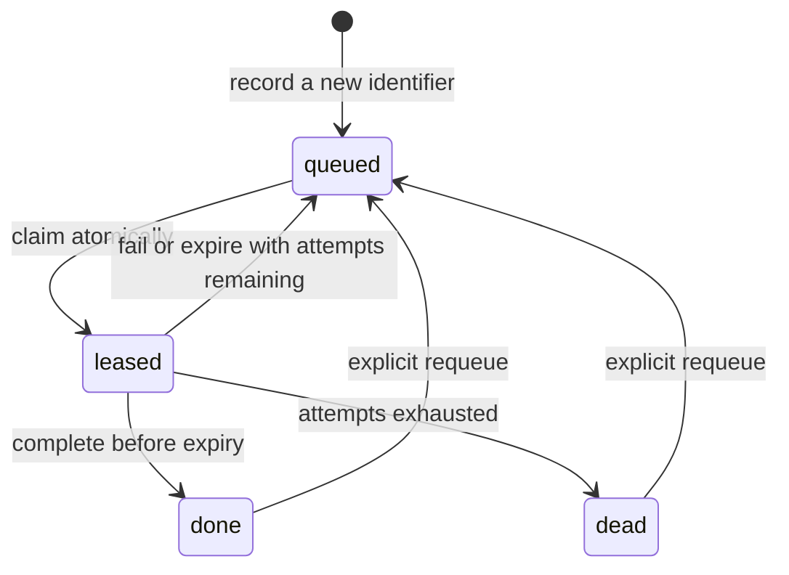

# Webhook Ledger

[](https://github.com/Dcastroro/webhook-ledger/actions/workflows/ci.yml)

**Track delivery receipts. Coordinate retries. Keep event data out of the ledger.**

A local SQLite receipt coordinator for webhook and event-processing workflows.
Deduplicate event identifiers, lease work atomically across processes, complete
or retry it, and recover abandoned leases after a deadline.

It stores **no payloads, headers, original event IDs or credentials**. Receipts
are random UUIDs; event IDs are represented by namespace-scoped one-way
fingerprints. Inspection and JSON reports expose operational metadata only.

Node.js 24.14+ · native SQLite · no third-party dependencies · no service account.

## Try it

```sh
git clone https://github.com/Dcastroro/webhook-ledger.git
cd webhook-ledger
npm ci --ignore-scripts
npm run demo
```

The demo uses an in-memory database and fictional identifiers. It deduplicates
a delivery, retries a failure, then completes the receipt:

```json
{
  "deduplicated": true,
  "final": {
    "version": 1,
    "retained": 1,
    "queued": 0,
    "leased": 0,
    "done": 1,
    "dead": 0,
    "expiredLeases": 0,
    "maxEntries": 100000,
    "maxAttempts": 2,
    "leaseMs": 30000
  }
}
```

## What this project owns



The ledger manages receipts and processing state. Your application owns webhook
signature verification, transport acknowledgement, payload storage and business
side effects. This project opens no HTTP server, fetches no provider data and
does not replay an HTTP request.

It is a coordinator for **one host and one local SQLite file**, not a distributed
message broker. SQLite serializes writers; short transactions allow several
local worker processes to share the ledger. Use a local filesystem, not NFS or
a shared network drive. See [design notes](docs/design.md).

## Use the API

```js
import { Ledger } from './src/ledger.mjs';

const ledger = new Ledger('./receipts.sqlite', {
  maxEntries: 100000,
  maxAttempts: 5,
  leaseMs: 30000
});

try {
  // An identifier, never a webhook payload or authorization header.
  const record = ledger.record('fictional-delivery-one');
  // Associate record.receipt with data in your separate, trusted payload store.

  const [lease] = ledger.claim();
  if (lease) {
    // Load prepared data by lease.receipt and perform an idempotent action.
    // This example performs no external action.
    lease.complete();
  }
} finally {
  ledger.close();
}
```

`record()` returns `{ inserted, receipt, state }`. A retained duplicate returns
the existing receipt and never resets its state or retry count. Identifiers are
exact, case-sensitive strings; no whitespace normalization occurs.

Use `recordBatch(ids)` for 1–1,000 IDs in one all-or-nothing transaction. Raw IDs
are hashed in memory before any value is bound into SQLite. They are not
available again through this API.

### Lease ownership stays inside the object

`claim({ limit: 10 })` returns lease objects. Each exposes only `receipt`,
`attempt` and `leaseUntil`, plus `complete()` and `fail({ delayMs: 1000 })`.
Ownership material stays in a closure and only its digest is stored in SQLite.
It is not exported, printed, returned by `toJSON()` or shown by Node inspection.

The completion update checks receipt, ownership digest, state and expiry
atomically. An old worker cannot complete a newer worker's lease. Completing a
lease twice fails with `lease-lost`. Closing the ledger invalidates its handles.

### Handle writer contention explicitly

The API reports a fixed `storage-busy` code when its lock wait is exhausted.
`withBusyRetry` provides opt-in, finite exponential backoff for **one ledger
operation**, without retrying unrelated business side effects:

```js
import { Ledger, withBusyRetry } from './src/ledger.mjs';

const ledger = await withBusyRetry(
  () => new Ledger('./receipts.sqlite', { busyMs: 100 }),
  { attempts: 32 }
);
try {
  const leases = await withBusyRetry(() => ledger.claim({ limit: 10 }));
  for (const lease of leases) {
    // Perform your idempotent action separately.
    await withBusyRetry(() => lease.complete());
  }
} finally {
  ledger.close();
}
```

Default backoff: 8 attempts, initial 20 ms delay, capped at 250 ms. Attempts
are capped at 32; only `storage-busy` is retried. Capacity, expiry and other
errors stay explicit. Total latency includes each operation's configured busy
wait; keep that budget below the lease deadline. Existing ledger connections
read settings without acquiring an unnecessary writer transaction.

A failure schedules another attempt after the requested delay. At the attempt
limit it becomes `dead`. `claim()` also recovers up to 1,000 expired leases per
call, making them queued or dead according to the same limit. Recovery is
performed when claiming; there is no background scheduler.

Keep batches and processing duration within the lease window. There is no lease
extension in this release. If work can exceed the deadline, split it or choose a
suitable deadline when creating the ledger. System clocks must be consistent;
moving the clock backward/forward affects availability and expiry.

### Delivery guarantees

The coordination model is **at least once**, with an attempt limit and retention
window. It does not provide exactly-once business effects. A process can finish
an external action and crash before completing its lease, so handlers must be
idempotent or fenced in the system that owns the effect.

The ledger and an external payload store do not share a transaction. You must
prepare the receipt-to-payload mapping before workers rely on it, and recover
partial ingestion explicitly. Do not acknowledge webhook delivery solely because
`record()` succeeded. See [integration boundaries](docs/integration.md).

## Inspect from the command line

```sh
node bin/webhook-ledger.mjs init --db receipts.sqlite
node bin/webhook-ledger.mjs import --db receipts.sqlite --input examples/event-ids.json
node bin/webhook-ledger.mjs stats --db receipts.sqlite
node bin/webhook-ledger.mjs list --db receipts.sqlite --state queued --limit 100
```

Import accepts only a JSON array of ID strings, up to 1 MiB/1,000 entries.
Payload objects are rejected. IDs are read from the input file rather than
command arguments. The import response contains inserted/duplicate counts;
listing exposes random receipt IDs and state/timing metadata.

The CLI has no `claim`, `complete`, secret-dump or raw-event command. Work is
claimed and settled through the API so live ownership does not enter command
arguments or terminal output. Every normal CLI response is one JSON document.

| Command | Additional options |
| --- | --- |
| `init`, `stats` | None |
| `import` | `--input <file>` |
| `list` | `--state queued\|leased\|done\|dead`, `--after <cursor>`, `--limit 1..1000` |
| `requeue` | `--receipt <uuid>`; only done/dead receipts |
| `prune` | `--before <epoch-ms>`, `--limit 1..1000` |

Paths resolve from the current directory; quote paths containing spaces. Parent
directories must already exist. `init`, inspection commands and API construction
create a new ledger if the target file is absent. Use an existing path carefully.
Help/version need no database. Exit `0` means success; exit `2` means a fixed-code
input, state or storage error. Raw paths and SQLite messages are not printed.

## Capacity and retention

| Setting/bound | Default | Range |
| --- | --- | --- |
| Retained receipts | 100,000 | 1–1,000,000 |
| Attempts | 5 | 1–100 |
| Lease duration | 30 seconds | 100 ms–1 hour |
| Busy wait | 5 seconds | 1 ms–5 seconds |
| Import/claim/list/prune batch | See API/CLI | At most 1,000 |
| Identifier UTF-8 length | — | 1–1,024 bytes, well-formed Unicode, no null byte |
| Main SQLite pages | 32,768 | Fixed bound for this release |

Capacity, attempt limit and lease duration are persisted. Reopening without
options uses stored settings; an explicit conflicting setting fails. Capacity
is checked under the same writer transaction as insertion. Duplicates still
succeed when full. New over-capacity batches roll back completely.

`list({ after, limit, state })` uses keyset cursors, not large offsets. `stats()`
uses a coherent read snapshot. Inserts maintain a transactionally updated
retained-count field, so capacity checks do not scan the receipt table.

`prune({ before, limit })` deletes only old `done`/`dead` rows in bounded batches.
It never removes queued/leased work. Pruning ends deduplication for removed
identifiers: a future delivery can get a new receipt. `requeue(receipt)` is an
explicit replay of terminal work and resets attempts; it cannot recover a
payload because none was stored here.

SQLite uses WAL, full synchronous durability and checkpoints. The main-page
bound is about 128 MiB at the default 4 KiB page size, not a hard quota for all
sidecar files. Long-lived external readers can delay WAL reuse. Pruning reuses
pages but does not automatically shrink the file. See [operating notes](docs/design.md).

## Security and limits

No embedded credentials, `.env` loading, provider SDKs, network calls or shell
execution are required by the shipped CLI/library. Event payloads, headers,
original IDs, exception text and claim ownership material stay out of reports.
The SQLite file is ignored by Git; the application must protect its directory
and backups using operating-system permissions.

The database is **not encrypted**. Fingerprints reduce accidental exposure;
they do not hide low-entropy IDs from an operator who can read the database and
its namespace. This is not a secret scanner, authentication service, payload
queue or defense against a compromised host. See [SECURITY.md](SECURITY.md).

SQLite calls are synchronous and can wait for a writer lock. Use dedicated
workers rather than placing this directly on a latency-sensitive request loop.
The included 10,000-receipt and multi-process fixtures are correctness tests,
not a throughput SLA or a multi-host scaling claim.

## Development

```sh
npm ci --ignore-scripts
npm run check
```

CI runs Windows/Ubuntu on Node.js 24 and 26. The library selects the native
SQLite class available in the runtime; native SQLite API stability/warnings
follow that Node release. This first version runs from source and is not
published to npm.

See [VALIDATION.md](VALIDATION.md), [API notes](docs/api.md),
[CONTRIBUTING.md](CONTRIBUTING.md) and [ROADMAP.md](ROADMAP.md).
MIT license. Created by David Castro.
